# NF1.UD4. AA1-NFS: Demostració i Configuració d'un Servidor NFS per a DevOptimize Solutions

---

<br>

## Fase 1: Preparació de l'entorn

Abans de començar la configuració dels serveis, preparem la xarxa i comprovem la connectivitat entre les màquines:
- **Servidor (Ubuntu Server):** Interfície 1 en "Xarxa NAT" i Interfície 2 en "Xarxa només-amb-amfitrió".
- **Client (Zorin OS):** Configuració de xarxa adaptable per a les proves (NAT / Només-amb-amfitrió).

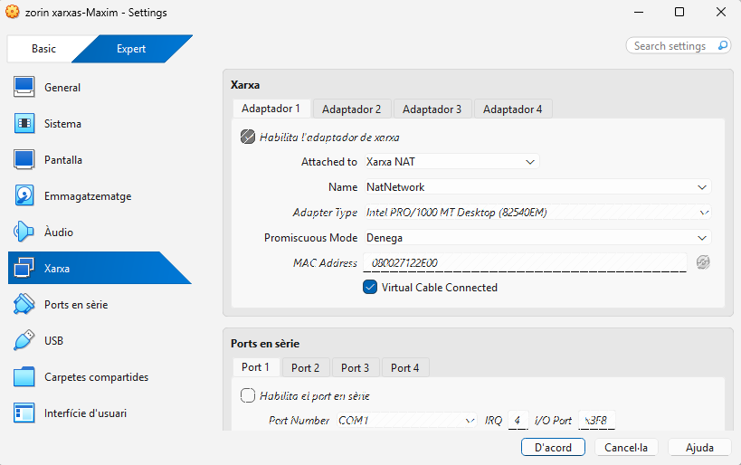

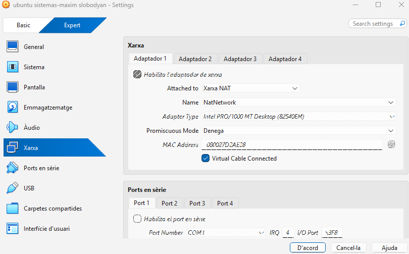

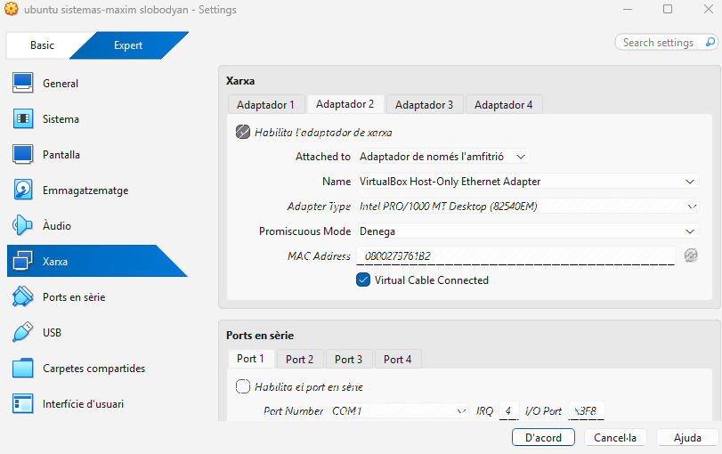

Actualitzem els repositoris i sistemes a totes dues màquines:

```bash
sudo apt update && sudo apt upgrade -y
```

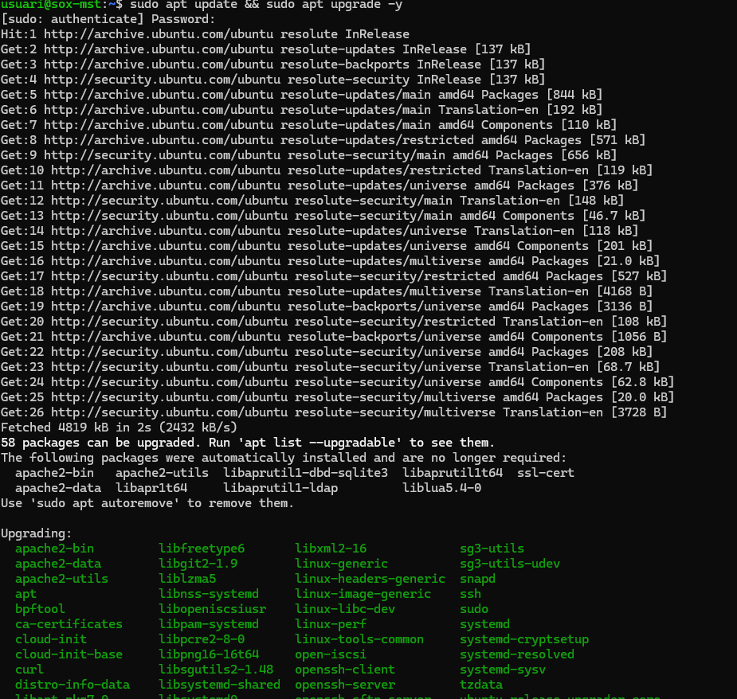

---

<br>

## Fase 2: Preparació i configuració del Servidor i Creació de directoris i assignació de permisos

### Creació de grups i usuaris

Creem els grups `devs` i `admins` juntament amb els usuaris corresponents (`dev01` i `admin01`).

```bash

sudo addgroup devs
sudo addgroup admins


sudo adduser devs
sudo adduser admins
```
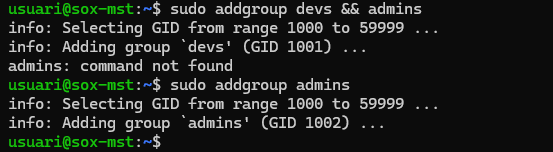

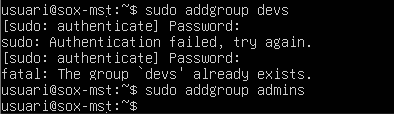
```bash
sudo usermod -aG devs dev01
sudo usermod -aG admins admin01
```

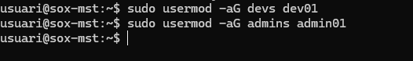
```
sudo adduser dev01
sudo adduser admin01
```

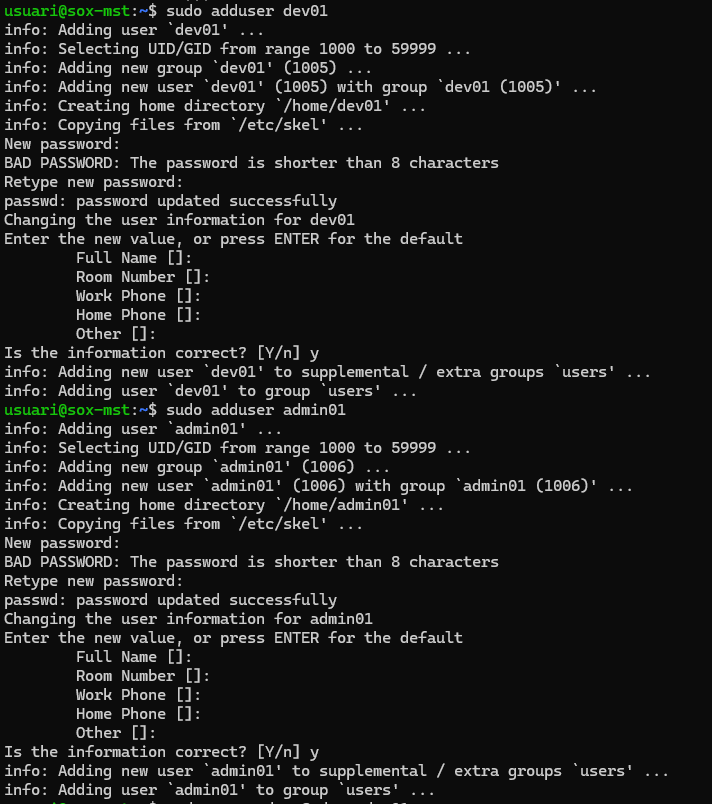

Creem els directoris compartits a `/srv/nfs/` i configurem els permisos locals (UGO):
- L'usuari propietari serà `root`.
- El grup `devs` tindrà accés total a `/srv/nfs/dev_projects`.
- El grup `admins` tindrà accés total a `/srv/nfs/admin_tools`.

```bash

sudo mkdir -p /srv/nfs/dev_projects
sudo mkdir -p /srv/nfs/admin_tools
```
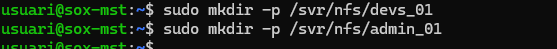


### Instal·lació del servei NFS

Instal·lem el servei de servidor NFS:

```bash
sudo apt install nfs-kernel-server -y
```

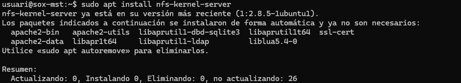

---

<br>

## Fase 3: L'Exportació d'Administració (El Dilema del root_squash)

Analitzarem el comportament de la seguretat per defecte de NFS quan l'usuari `root` del client intenta escriure en un recurs compartit.

### Prova 1: Error comú (`root_squash` actiu per defecte)


Apliquem els canvis:
```bash
sudo exportfs -ra
sudo exportfs -v
```

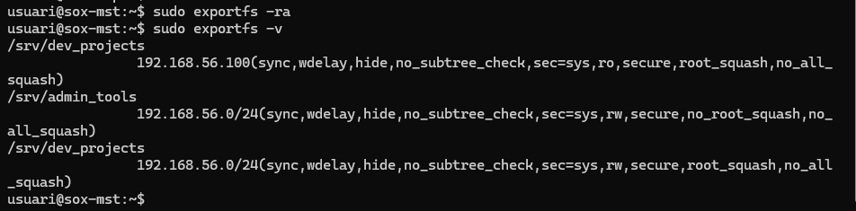

**Al Client:** Instal·lem `nfs-common`, creem el punt de muntatge i intentem crear un fitxer com a `root`:

```bash
sudo apt install nfs-common
findmnt /mnt/admin_tools
findmnt /mnt/dev_projects
sudo touch /mnt/admin_tools/test_root.txt
```

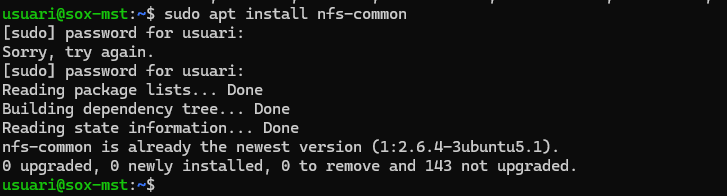

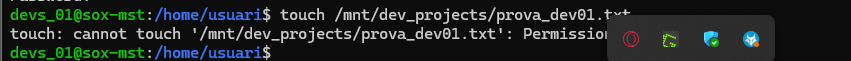

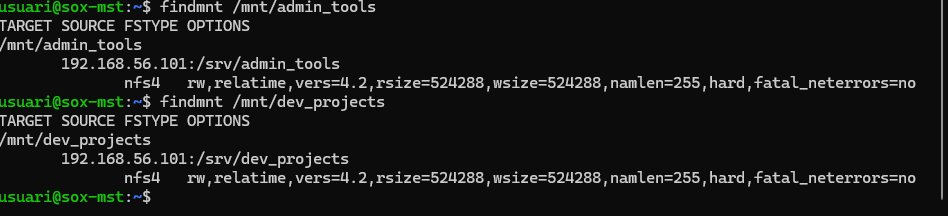

#### Resposta i Justificació Tècnica (Prova 1):
* **Resultat:** L'operació és denegada (*Permission denied*).
* **Explicació:** Per defecte, NFS s'executa amb l'opció `root_squash` activada. Aquesta mesura de seguretat mapeja qualsevol petició feta per l'usuari `root` del client cap a un usuari anònim sense privilegis (`nobody` o `nfsnobody`). Com que el directori local `/srv/nfs/admin_tools` té permisos `770` i pertany a `root:admins`, l'usuari anònim no té permís d'escriptura.

---

### Prova 2: La Solució (`no_root_squash`)

*Al Client:** Desmuntem, tornem a muntar i provem de nou:

```bash
sudo mount -t nfs IP_servidor:/srv/nfs/admin_tools /mnt/admin_tools
sudo touch /mnt/admin_tools/test_root.txt
ls -l /mnt/admin_tools/test_root.txt
```

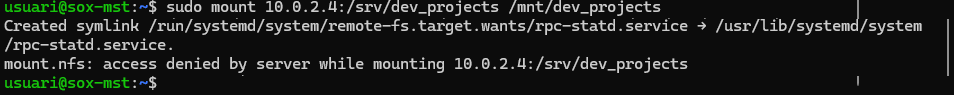

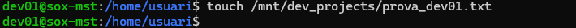

#### Resposta i Justificació Tècnica (Prova 2):
* **Resultat:** El fitxer es crea satisfactòriament i el seu propietari apareix com a `root`.
* **Explicació:** Amb `no_root_squash`, el servidor NFS confia plenament en la identitat de l'usuari `root` del client, permetent-li mantenir els privilegis de superusuari directament sobre el sistema de fitxers exportat.

---

<br>

## Fase 4: Exportació de Desenvolupament (Permisos rw vs ro i permisos de sistema)

---

### Proves d'accés des del Client

#### Prova
1. Muntem el recurs al client:

```bash
   sudo mkdir -p /mnt/dev_projects
   sudo mount -t nfs IP_servidor:/srv/nfs/dev_projects /mnt/dev_projects
 ```

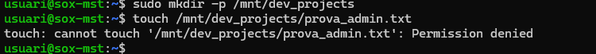


---

#### Prova
1. Desmuntem el recurs i canviem manualment la IP del client a la IP configurada com a `ro` (`192.168.56.150` o `10.0.2.100`).
2. Remuntem i intentem escriure com a `dev01`:

```bash
   sudo umount /mnt/dev_projects
 ```

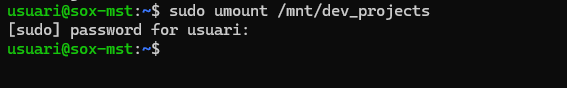

---

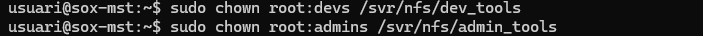


---

<br>

## Fase 5: Muntatge Automàtic amb `/etc/fstab`

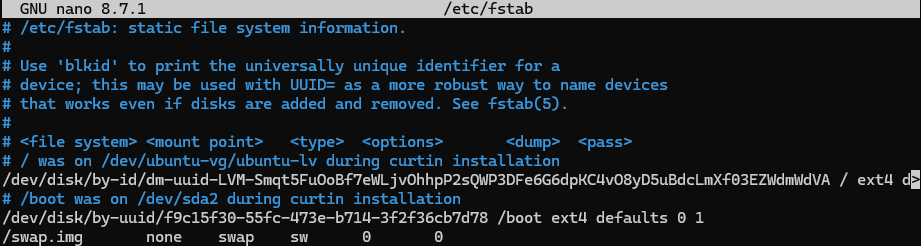

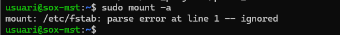

```bash
sudo mount -a
```